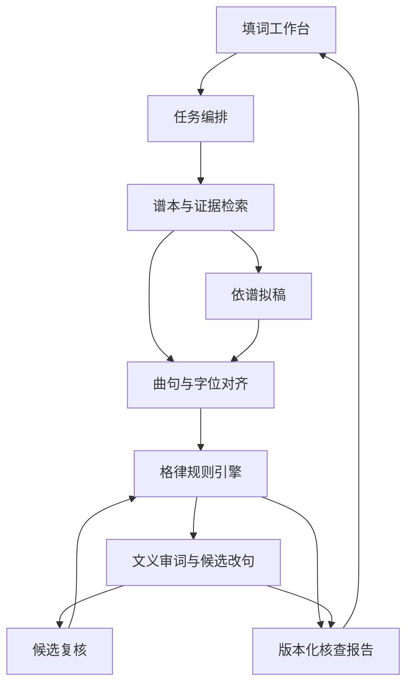

# 曲稿 · 系统架构设计

[功能与界面](product.md) · [规则及拟建资料清单](../checklist.md)

## 部署与职责

首版建议采用浏览器工作台、一个 Python 应用及 SQLite。前端可用 React + TypeScript。应用内将生成、检索、规则执行和持久化分为模块，共享一次任务的版本快照。模型通过单独的适配接口接入，可在测试时替换。同一写作 Agent 负责两种入口，检查规则复用现有编号。此处描述待实现的系统。

现稿由编排器直接传给对齐模块；起草先解析底谱，再生成候选稿。候选复核只执行规则和报告比较，默认每条建议最多生成一次替代稿，不能因模型反复改词而无限循环。整稿初查完成即可阅读，文义批注随后附到同一稿次。

## 数据契约

| 实体 | 最小字段与约束 |
|---|---|
| 任务与稿次 | task_id、模式、目标牌、可选语境；revision_id、父稿次、原文、支曲边界。保存不可变稿次，工作台单独保存当前指针 |
| 谱本快照 | 曲牌与体式标识、谱本版本、韵书与口径、规则集版本、资料快照 ID。每个谱位明确标注强制、通融、例见或未知 |
| 对齐与读法 | 每支、句、字位有稳定标识；原文范围采用 Unicode 码点半开区间，保留到显示字形的映射。衬字、缺位和合前复用另记。每个读法候选绑定义项、历史声类、阴阳、韵部和证据 |
| 证据 | source_id、书名、版本、卷篇页或条目、可核定位、原注、适用条件与证据等级；模型只能引用本次返回的证据 ID |
| 诊断 | run_id、稿次、规则号、适用范围、判定、原文位置、预期与实际、候选读法、证据 ID 或缺证原因。模板冲突另有阻断标记 |
| 改句 | 建议 ID、基线稿次、目标范围、原句和替换文本、理由、改后规则差异。采纳校验基线及原文，提交新稿次 |

## 规则执行与审词

规则注册表逐项绑定适用条件、所需 D 库、执行器及诊断级别。首版接口覆盖现行 28 个 K 编号和 7 个 H 编号，实际启用项由谱本覆盖决定。资料尚待录入，产品可公开列出每一曲牌当前具备的校验能力。

| 调用范围 | 规则和证据 |
|---|---|
| 确定模板、分句与对齐 | K01–K06。以 D01、D02 定曲牌和字位，以 D08 识别有据通融。K01 冲突暂停该模板下的后续检查 |
| 声类、韵位、用韵与复现 | K07–K24、K32。按具体规则取 D02、D05–D09；涉及韵段、合前时取 D04。K06、K18–K24 等提示项沿用原表级别 |
| 结构与联套 | K25 核谱定对偶结构；K26、K27 只用于联套。K16 的换韵、K18 的复用按原表的适用条件触发 |
| AI 审词 | H03、H11、H12、H14、H15、H17、H19。按规则取对应字句、K 结果及 D11、D13、D14 等材料。输出原句、理由、可选改法及证据。缺少典源时明确注明 |

逐位求读法时，同一候选须同时满足适用的声类、阴阳、韵部与位置限制。候选之间结论分歧则待核；资料完备且所有候选均违反明文强制条件才报失律。适用条件明确排除则跳过。例见只支持举例。以 K14 为例，同支鱼模细分类只有在采用李渔口径且 D07 有相应证据时参与判断。H15 可就韵脚是否贴意提出改法，不能改变 K14 的判定。

改单句时，先重算该句字位及相邻对偶，再按依赖重算同支重字、韵脚和相同韵段。改曲牌、体式、套序或底本使整稿结果失效。首版可对整稿全量重算以保证正确；局部计算须与全量结果一致后再启用。

## 接口、保存与故障处理

| 接口 | 行为 |
|---|---|
| POST /tasks | 接收 I01 与可选 I02；返回任务 ID、匹配的谱本或待选择的候选 |
| POST /tasks/{id}/drafts | 依题意起草或原样导入现稿，返回稿次 ID；重复请求按幂等键复用 |
| POST /tasks/{id}/revisions | 携父稿次保存手改；若当前稿次已前移，返回冲突与最新稿次，保留本地输入 |
| POST /revisions/{id}/checks | 绑定资料与规则快照，启动核查；返回 run_id。GET /runs/{id} 返回分阶段状态、覆盖情况及诊断 |
| POST /revisions/{id}/suggestions | 指定字句与修改意图，生成候选、预检并返回差异；采纳通过 POST /suggestions/{id}/apply 原子创建稿次 |
| GET /evidence/{id} | 返回可定位的版本、卷页及证据片段。导出使用相同证据标识 |

任务记录保存阶段、错误原因与可重试标识。切换稿次时丢弃迟到的旧报告显示，旧稿仍能回看。任务、稿次和报告按所属工作区访问，公开仓库只承载项目文档。模型只接收当前步骤所需文本和证据。检索缺失按规则输出待核；模型不可用时保留确定性格律报告。

## 交付顺序与验证

1. 先用一南一北两个有谱页线索的曲牌贯通两条路径。可从【皂罗袍】与【天净沙】试录，逐位验过的谱据决定上线覆盖。初期只需录入支撑样例的条目，11 类资料沿用规则表中的书目。
2. 为每条启用的强制规则配置符合、明确违反、证据不足的样稿；另测模板错配、多音字跨候选误拼、同支混押与跨支许可、合前展开去重。固定谱本和规则版本后，相同词稿的 K 结果应可重复。
3. 在同一份词稿上跑起草、校订、采纳、撤销、编辑冲突和失败重试。核对字位定位、谱据回查、旧诊断隔离和导出稿次。H 类抽查建议是否贴原句、典源是否可定位、改句是否引入新失律。
4. 单支流程通过后再接入联套。套序、换韵和尾牌只有在对应 D04 证据可用时给出确定结论。
