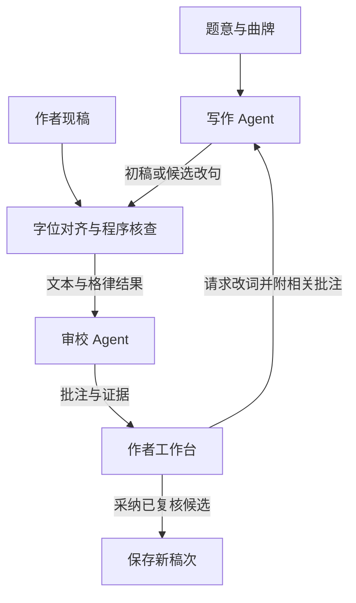

# 曲稿 · 系统架构设计

[功能与界面](product.md) · [规则及拟建资料清单](../checklist.md)

## 部署与职责

首版建议采用浏览器工作台、一个 Python 应用及 SQLite。前端可用 React + TypeScript。应用内将生成、检索、规则执行和持久化分为模块，共享一次任务的版本快照。模型通过单独的适配接口接入，可在测试时替换。系统只有两个 Agent：写作 Agent 负责起草与改词，审校 Agent 负责审稿与复核。任务编排、资料检索、字位对齐和 K 类规则执行均为程序模块。此处描述待实现的系统。

| 角色 | 每轮输入 | 对外交付 |
|---|---|---|
| 写作 Agent | 题意或原稿、目标谱格、适用写作提示；改词时另收目标句、作者要求和相关审校意见 | 初稿或带基线稿次的候选改句，标出改动范围 |
| 审校 Agent | 待审文本、题意、同一底谱快照、程序核查结果和适用的 H 类审词提示；复核时另收原稿及差异 | 定位到字句的意见、理由、证据和修改方向；词稿由作者决定是否采纳改动 |

两者使用独立的角色提示，共享选定的曲牌与资料快照，均可调用只读工具查证。审校 Agent 按需独立核对写作时引用的条目。编排器把批注绑定到具体稿次和原句，作者请求改词时才交给写作 Agent；候选先跑程序检查，再由审校 Agent 复核原问题是否解决及相关句子是否出现新问题。复核结果回到工作台，每次改写由明确请求触发。贴词校订直接从作者现稿进入核查，首次审校保留原文。

## 写作 Agent 每轮取得什么

作者选定曲牌后，编排器先解析底本和体式。每次起草或改句请求都装入下表前两层，再附本次题意、可选语境、当前稿次和目标句。第三层由模型在写作中主动调用。作者只需表达创作意图，资料准备由系统完成。

| 层次 | 内容与生成方式 | 何时变化 |
|---|---|---|
| 曲牌固定上下文 | 从 D01、D02 按选定体式编出逐句谱格。每句列正字位、句读、衬位、韵位、声类和对偶关系，附版本、证据 ID、已知通融及缺项。联套另取 D04 的支序和韵段。 | 按曲牌、体式、底本、韵法、套式及资料版本缓存。同一设定下改题意、换字时复用；换谱或换韵法时重新构建。 |
| 规则提示词 | 在规则注册表为各编号增设适用范围、写作阶段、提示文本与版本。编排器按单支或联套、起草或局部改写、当前句位筛选。起草加载适用的句格、用韵、遣词要求；改韵脚追加相关读法与贴意要求。 | 每轮重选。保留“强制／提示／待核”的力度与规则号。程序与提示词共用规则版本；最终格律判定交规则引擎。 |
| 按需工具 | 初始化时只给模型工具名、参数和用途。模型写到具体字词时发起结构化请求；执行器锁定本次资料快照，将命中条目及出处返回给该轮模型。 | 每次查询产生独立结果。缓存键含工具、参数、适用音系与资料版本。跨稿次复用条目时，重新判断其是否适合当前句义。 |

例如改一个必押字时，可给模型以下两条提示。K15：“保留同一读法的声类与韵部，选字须同时满足本位两项要求。” H15：“先读全句，再比较备选韵字是否改变原意。”具体要押哪一韵、哪一位要求什么声类，直接读取曲牌及本稿已定韵段。这样，规则提示可以跨曲牌复用。

### 模型可调用的只读工具

| 接口与参数 | 返回给写作 Agent 的信息 |
|---|---|
| `lookup_character(字, 上下文, 字位)` | 查 D05、D13，逐读法给出义项线索、历史声类、阴阳、韵部及位置限制，分别附出处。必要时按 D08 核许可。 |
| `find_rhyme_words(韵部, 声类, 字位, 可选义项)` | 按本次韵书筛出有依据的候选读法及用字；语义匹配可用于排序。写入词稿后仍做整句和韵段复核。 |
| `lookup_allusion(典名或引语, 目标句意)` | 从 D13 检索原典，返回原句、必要上下文、篇卷和定位；多个可能典源分列。D11 的后世用例单列为化用参考。 |
| `lookup_examples(曲牌, 体式, 可选句位)` | 从 D11 返回少量同体例句、作者作品和定位，供比较章法、措辞。例句保留“例见”标记。 |

工具执行器统一回传查询状态（命中、多解、未收录或暂时失败）、条目及证据 ID，校验查询属于当前资料快照。编排器记录所用提示版本、调用参数、结果 ID 和对应稿次。每轮设可配置的调用数和时限，重复查询复用结果。达到上限时交付现有草稿并注明尚缺的依据；模型不得补造字典条目或典源。

### 一次改句如何走完

作者为【皂罗袍】单支补充题意“雨后独游”，要求保留原句的一处典故、换掉韵脚。编排器复用该体式的谱格，取目标句、同韵段原句和作者指定保留的文字，装入 K14、K15、H11、H15 等适用提示。模型先查典源确认保留哪些字，再按韵部检候选、查候选字在句中的义读，提出改句。程序重算格律，审校 Agent 复核典意与韵脚贴意程度，界面并列原句、改句、格律变化和可点开的证据。若典源未收录，保留作者原文并标记出处待核；另一候选韵脚的读法有据时，仍可单独给出其格律结果。

开发验收需重放三种场景：同谱改句复用曲牌上下文且更新阶段提示；切换同名别体后按新谱位查字；查典未命中时保留原稿、无虚构出处。记录模型实际收到的上下文标识、规则号与工具轨迹以供核对。

## 数据契约

| 实体 | 最小字段与约束 |
|---|---|
| 任务与稿次 | task_id、模式、目标牌、可选语境；revision_id、父稿次、原文、支曲边界。保存不可变稿次，工作台单独保存当前指针 |
| 谱本快照 | 曲牌与体式标识、谱本版本、韵书与口径、规则集版本、资料快照 ID。每个谱位明确标注强制、通融、例见或未知 |
| 对齐与读法 | 每支、句、字位有稳定标识；原文范围采用 Unicode 码点半开区间，保留到显示字形的映射。衬字、缺位和合前复用另记。每个读法候选绑定义项、历史声类、阴阳、韵部和证据 |
| 证据 | source_id、书名、版本、卷篇页或条目、可核定位、原注、适用条件与证据等级；模型只能引用本次返回的证据 ID |
| 诊断 | run_id、稿次、规则号、适用范围、判定、原文位置、预期与实际、候选读法、证据 ID 或缺证原因。模板冲突另有阻断标记 |
| 改句 | 建议 ID、基线稿次、目标范围、原句和替换文本、理由、改后规则差异。采纳校验基线及原文，提交新稿次 |

## 规则执行与审词

规则注册表逐项绑定适用条件、所需 D 库、执行器及诊断级别。首版接口覆盖现行 28 个 K 编号和 7 个 H 编号，实际启用项由谱本覆盖决定。资料尚待录入，产品可公开列出每一曲牌当前具备的校验能力。

| 调用范围 | 规则和证据 |
|---|---|
| 确定模板、分句与对齐 | K01–K06。以 D01、D02 定曲牌和字位，以 D08 识别有据通融。K01 冲突暂停该模板下的后续检查 |
| 声类、韵位、用韵与复现 | K07–K24、K32。按具体规则取 D02、D05–D09；涉及韵段、合前时取 D04。K06、K18–K24 等提示项沿用原表级别 |
| 结构与联套 | K25 核谱定对偶结构；K26、K27 只用于联套。K16 的换韵、K18 的复用按原表的适用条件触发 |
| AI 审词 | H03、H11、H12、H14、H15、H17、H19。按规则取对应字句、K 结果及 D11、D13、D14 等材料。审校 Agent 输出原句、理由、修改方向及证据。缺少典源时明确注明 |

逐位求读法时，同一候选须同时满足适用的声类、阴阳、韵部与位置限制。候选之间结论分歧则待核；资料完备且所有候选均违反明文强制条件才报失律。适用条件明确排除则跳过。例见只支持举例。以 K14 为例，同支鱼模细分类只有在采用李渔口径且 D07 有相应证据时参与判断。H15 可就韵脚是否贴意提出改法，不能改变 K14 的判定。

改单句时，先重算该句字位及相邻对偶，再按依赖重算同支重字、韵脚和相同韵段。改曲牌、体式、套序或底本使整稿结果失效。首版可对整稿全量重算以保证正确；局部计算须与全量结果一致后再启用。

## 接口、保存与故障处理

| 接口 | 行为 |
|---|---|
| POST /tasks | 接收 I01 与可选 I02；返回任务 ID、匹配的谱本或待选择的候选 |
| POST /tasks/{id}/drafts | 依题意起草或原样导入现稿，返回稿次 ID；重复请求按幂等键复用 |
| POST /tasks/{id}/revisions | 携父稿次保存手改；若当前稿次已前移，返回冲突与最新稿次，保留本地输入 |
| POST /revisions/{id}/checks | 绑定资料与规则快照，启动核查；返回 run_id。GET /runs/{id} 返回分阶段状态、覆盖情况及诊断 |
| POST /revisions/{id}/suggestions | 指定字句与修改意图，由写作 Agent 拟候选，程序预检后交审校 Agent 复核并返回差异；采纳通过 POST /suggestions/{id}/apply 原子创建稿次 |
| GET /evidence/{id} | 返回可定位的版本、卷页及证据片段。导出使用相同证据标识 |

任务记录保存阶段、错误原因与可重试标识。切换稿次时丢弃迟到的旧报告显示，旧稿仍能回看。任务、稿次和报告按所属工作区访问，公开仓库只承载项目文档。模型只接收当前步骤所需文本和证据。检索缺失按规则输出待核；模型不可用时保留确定性格律报告。

## 交付顺序与验证

1. 先用一南一北两个有谱页线索的曲牌贯通两条路径。可从【皂罗袍】与【天净沙】试录，逐位验过的谱据决定上线覆盖。初期只需录入支撑样例的条目，11 类资料沿用规则表中的书目。
2. 为每条启用的强制规则配置符合、明确违反、证据不足的样稿；另测模板错配、多音字跨候选误拼、同支混押与跨支许可、合前展开去重。固定谱本和规则版本后，相同词稿的 K 结果应可重复。
3. 在同一份词稿上跑起草、校订、采纳、撤销、编辑冲突和失败重试。核对字位定位、谱据回查、旧诊断隔离和导出稿次。H 类抽查建议是否贴原句、典源是否可定位、改句是否引入新失律。
4. 单支流程通过后再接入联套。套序、换韵和尾牌只有在对应 D04 证据可用时给出确定结论。
