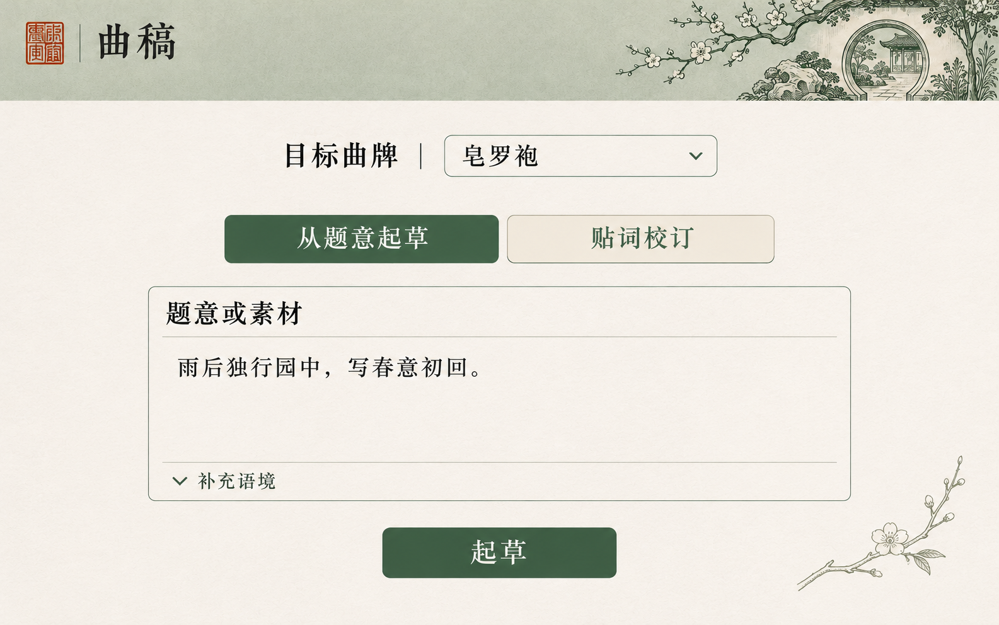
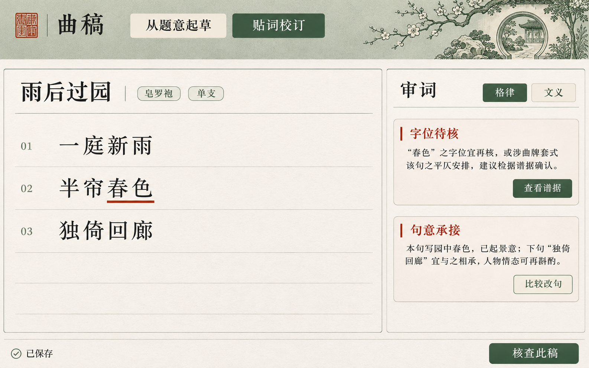

# 曲稿 · 功能与交互设计

「曲稿」是昆曲填词工作台的暂定名。作者可以带着题意来起草，也可以带着现稿来校订。两条路径地位相同，进入同一份可逐句修改、可查看谱据的词稿。首版按个人桌面写作设计。

[系统架构](architecture.md) · [现行检查规则与资料来源](../checklist.md)

## 从一份任务开始

| 步骤 | 从题意起草 | 贴词校订 |
|---|---|---|
| 输入 | 选目标曲牌，写题意或给几句素材 | 选目标曲牌，粘贴原稿，保留原字形、标点、段落 |
| 确认依据 | 显示实际采用的谱本与体式。若同名异调会改变句格，列出候选及关键区别供选择 | 同样选择底谱；作者已指明的版本优先。有歧义的断句可在词稿上点选 |
| 首次结果 | 写作 Agent 依谱拟稿，程序核查格律，审校 Agent 附逐句意见；尚缺的证据随稿列明 | 先保存原稿，程序核查后由审校 Agent 定位现稿的问题；首次核查保留每个原字 |
| 继续写作 | 修改题意后可另拟一版，保留上一版；也可只圈一句重拟 | 点字句看依据、比较改法，也可自行修改并重查 |

任务只要求 I01。I02「补充语境」默认收起，容纳角色口吻、场景或典故线索。曲牌选择器同时显示异名、南北和底本覆盖。目标牌缺谱时仍可保存草稿、请求文义建议；需要依谱起草时说明缺哪一谱，保留当前输入供改选。只有作者选择联套，才展开支曲次序、韵段及尾牌。

## 在词稿上校订

桌面约三分之二用于连续阅读词稿，旁栏呈现所选字句的批注。点批注定位原字，点原字聚合同位的多条诊断。缺字以句内插入点显示。正文保留作者标点，按需叠显正衬、句读和韵位。窄屏按相同顺序显示正文，点批注打开底部面板，关闭后恢复原选区。

| 控件或状态 | 作者看到什么 | 动作及结果 |
|---|---|---|
| 格律 | 按失律、待核、提示筛选，摘要给出已查与待核项数 | 展开该处的实际用字、谱定条件、规则号、书名版本及卷页。缺证时写明缺项 |
| 文义 | 聚焦遣词、语意、对偶或用典，每条意见引回原句 | 展开审校理由；点「比较改句」请写作 Agent 拟候选，复核后与原句并列；有意重字可保留。主动略过该建议只影响当前稿次 |
| 比较改句 | 原句与候选逐字对照，并列改前、改后格律结果 | 作者可采纳、保留原句或手改。候选引入新失律要列明位置，原稿在采纳前保持可恢复 |
| 保存与导出 | 当前版本、保存状态、最近核查版本 | 自动保存，可撤销采纳，复制纯词稿或导出带谱本与核查记录的 Markdown |
| 待核与失败 | “此字有两种读法”“此谱未收录”或“审词暂未完成”等具体原因 | 有材料可补时给出单一针对性动作；服务超时可重试，已经完成的格律结果可读 |

图为视觉概念稿。图中的《雨后过园》是排版用片段；其字格及批语未经谱本核定。实现时，单支批注隐藏套式内容，“句意承接”归入文义，编号和出处从核查记录生成。

## 视觉与可读性

取昆曲曲本的横排校读场景，用淡米色纸面、墨色宋体正文、青绿主按钮和小面积朱笔标记构成层次。园林版画留在页眉，词稿区用浅色分句线。失律用实线和文字，待核用虚线和文字，审词意见用旁批符号；颜色之外仍可辨认。界面按钮用清晰的中文常规字形。键盘可从原句跳到批注、展开谱据、比较和返回。

## 首版验收

1. 同一曲牌分别从题意、现稿进入，均能到达逐句编辑页。首次校订前后，保存的原稿逐字一致。
2. 同名体式确实改变诊断时给出选择及影响。查不到源码页或读法时，相应位置显示待核；覆盖摘要可追到具体项。
3. 选择一句改写，先出现差异与复核结果。采纳后生成新稿次，撤销可恢复原文。其余手改句得以保留。
4. 单支隐藏联套控件。联套内改一个韵脚后，可从该诊断跳到同韵段的其他受影响位置。
5. 逐字定位能处理繁简异体、标点和衬字。窄屏与键盘路径均能看谱据并回到原句。
6. 格律服务或模型单独超时，作者仍可编辑、保存和重试失败环节。导出时清楚标明尚未完成的检查。
